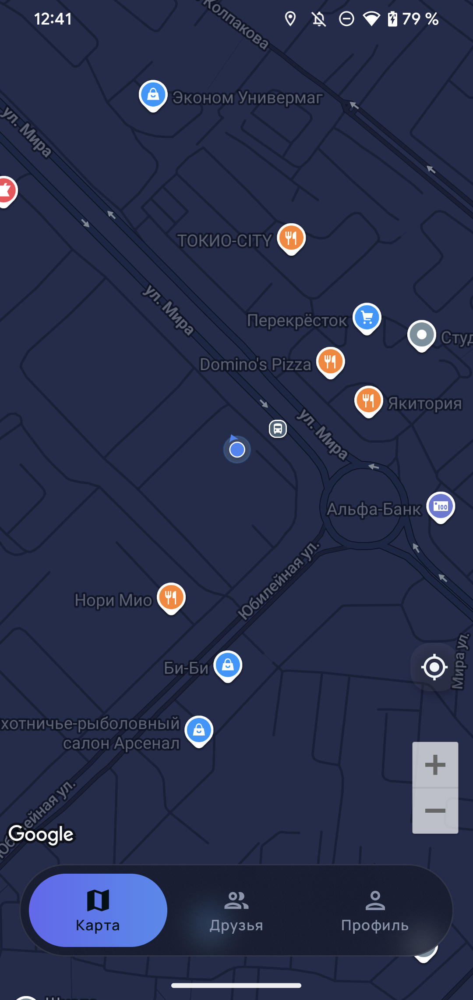
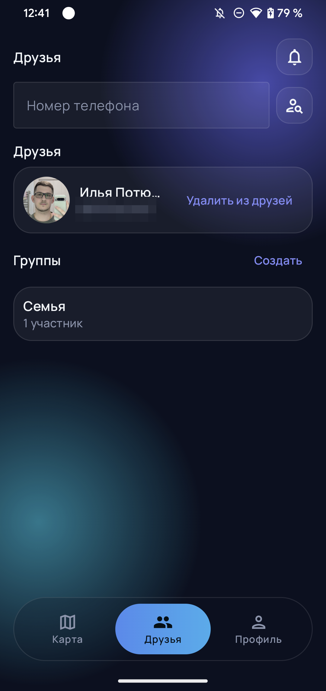
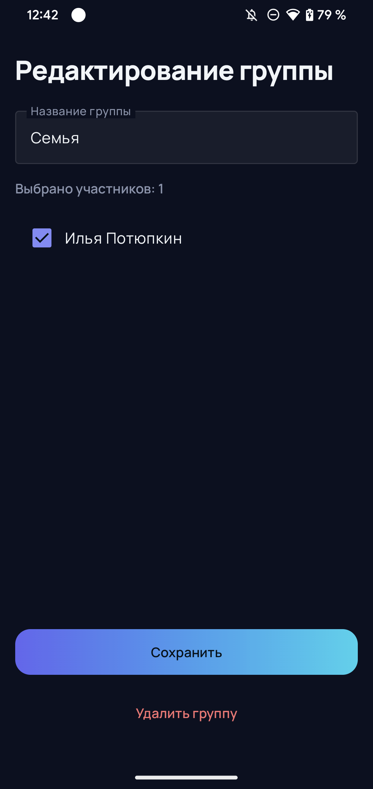
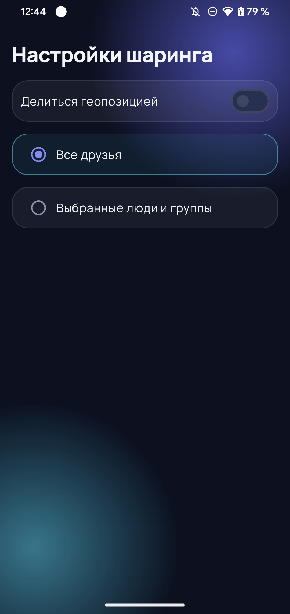
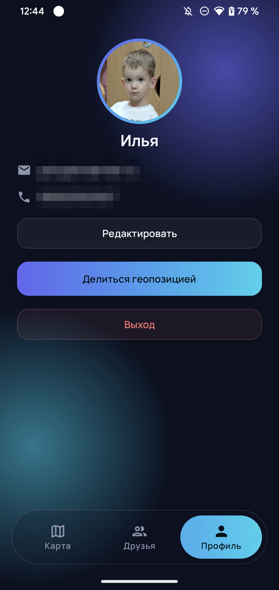
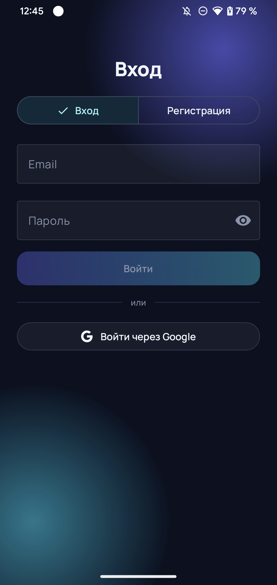
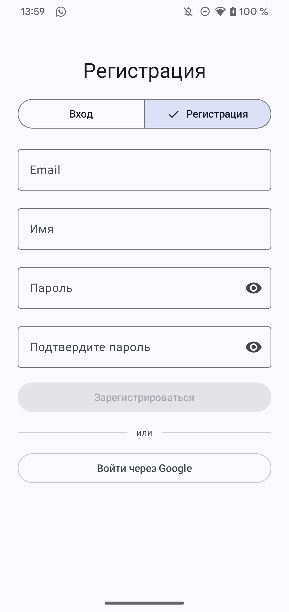

# ShareMyLocation

[](https://github.com/tyupik/ShareMyLocation/actions/workflows/android-release.yml)

Android-приложение для шаринга геолокации в реальном времени: добавляйте друзей по номеру телефона, объединяйте их в группы и смотрите, где они находятся, прямо на карте. Live-обновление позиций работает через Firestore-подписки, а отправка своей геопозиции — через foreground-сервис с интервалом 5 секунд.

Приложение написано с нуля за **2 дня** в связке с мультиагентным AI-пайплайном — детали в разделе [«Как это сделано»](#как-это-сделано).

## Скачать APK

Готовый подписанный APK публикуется в [GitHub Releases](https://github.com/tyupik/ShareMyLocation/releases/latest) —
скачивание доступно без авторизации. Список изменений каждой версии — в [CHANGELOG.md](CHANGELOG.md)
и в описании соответствующего релиза.


## Скриншоты

| Карта (realtime) | Друзья и группы | Редактор группы |
|:---:|:---:|:---:|
|  |  |  |

| Настройки шаринга | Профиль | Вход |
|:---:|:---:|:---:|
|  |  |  |

| Регистрация | | |
|:---:|:---:|:---:|
|  | | |

## Возможности

- **Авторизация** — email/password и Google Sign-In через Credential Manager
- **Профиль и онбординг** — имя, телефон, аватар; профиль хранится в Firestore
- **Друзья** — поиск по номеру телефона, заявки в друзья, realtime-список (без composite-индексов)
- **Группы** — создание групп друзей, редактор состава
- **Шаринг геолокации** — гибкие настройки видимости: все друзья или выбранные люди и группы
- **Отправка позиции** — foreground-сервис пишет геолокацию в `locations/{uid}` каждые 5 секунд
- **Live-карта** — маркеры друзей с аватарками обновляются в реальном времени, «моя точка», кнопка «Показать меня»

## Как это сделано

Приложение — эксперимент «полный цикл разработки с AI-агентами». Код написан не руками, а оркестрируемым конвейером агентов:

```
планировщик → разработчик → ревьюер ⟲ (цикл правок до APPROVE)
```

Роль человека — техлид и архитектор: постановка задач, декомпозиция фич, архитектурные стандарты (зафиксированы в `AGENTS.md`), приёмка результата. Пайплайн описан скиллом `dev-pipeline`, каждый фич-коммит прошёл через цикл «план → код → ревью».

Итог: от первого коммита до работающего продукта — **2 дня**, 11 фич-коммитов.

## Архитектура

MVI (State / Intent / Effect) + Clean Architecture:

```
Data → Repository (интерфейс в business) → Interactor (BusinessModel)
     → ViewModel → Converter (UiModel) → Compose UI
```

- **`business/`** — интеракторы, бизнес-модели, интерфейсы репозиториев
- **`data/`** — реализации репозиториев (Firebase, Credential Manager), Hilt-модули
- **`ui/`** — Compose-экраны: MVI-контракт (UiState/Intent/Effect) + ViewModel + конвертер

## Технологии

| Слой | Инструменты |
|---|---|
| UI | Jetpack Compose (BOM 2026.02.01), Material 3 |
| Архитектура | MVI, Clean Architecture, UDF |
| DI | Hilt 2.60 (KSP) |
| Навигация | Navigation 3 (`androidx.navigation3` 1.2.0) |
| Auth | Firebase Auth + Credential Manager |
| Данные | Cloud Firestore (realtime-подписки), Coroutines + Flow |
| Геолокация | Play Services Location, foreground-сервис |
| Язык | Kotlin 2.2, AGP 9.4 |

## Проект в цифрах

| Метрика | Значение |
|---|---|
| Строк Kotlin | ~12 800 |
| Файлов | 176 |
| Экранов | 8 |
| Доменных фич (`business/`) | 8: auth, contacts, friends, groups, map, notifications, profile, sharing |
| MVI ViewModel | 9 |
| Интеракторов / репозиториев | 21 / 14 |
| UI-composable | 56 |
| Время разработки | 2 дня (MVP) |

## Сборка и запуск

1. Клонируйте репозиторий:

   ```bash
   git clone https://github.com/tyupik/ShareMyLocation.git
   ```

2. Подключите свой Firebase-проект: положите `google-services.json` в `app/` (включите Authentication — email и Google — и Firestore).

3. Соберите и установите:

   ```bash
   ./gradlew installDebug
   ```

Требования: JDK 17+, Android SDK 35+.

## Структура проекта

```
ru.tyupik.sharemylocation/
├── business/          # интеракторы, бизнес-модели, интерфейсы репозиториев
│   ├── auth/ friends/ groups/ sharing/ ...
│   └── common/        # общие бизнес-модели (User)
├── data/              # реализации репозиториев
│   ├── auth/          # FirebaseBackend, AuthRepositoryImpl
│   └── ...
└── ui/                # Compose-экраны
    ├── auth/          # AuthScreen, AuthViewModel, AuthContract, AuthUiConverter
    ├── map/ friends/ groups/ profile/ sharing/ ...
    └── common/        # AppRoot, корневая навигация
```
